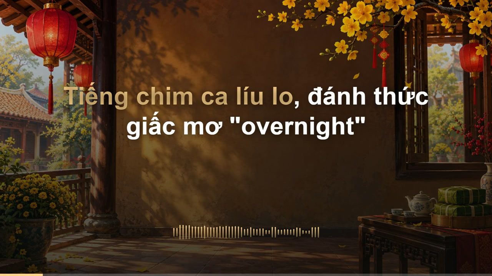

# Lydra · Lyric Video Studio

Tạo video lyrics và karaoke từ file nhạc cùng lời bài hát, chạy trên máy cá nhân và ưu tiên tiếng Việt. Dùng được với file xuất từ Lyria, Suno hoặc các công cụ tạo nhạc, thu âm khác; không cần kết nối tài khoản của những dịch vụ này.

## Demo

[](docs/demo/karaoke-demo.mp4?raw=true)

[Xem video demo karaoke (MP4, 20 giây)](docs/demo/karaoke-demo.mp4?raw=true)



## Cài đặt

Cần **Node.js 22+** và Git. Cài thêm **FFmpeg** nếu muốn lấy âm thanh từ video đầu vào.

Clone repo rồi cài đặt:

```sh
git clone https://github.com/kythuatdulieu/lyric-video-studio.git
cd lyric-video-studio
npm ci
cp .env.example .env
```

Mở `.env`, thay `your_openrouter_api_key` bằng key OpenRouter của bạn, rồi chạy:

```sh
npm run dev
```

Mở [localhost:3000](http://localhost:3000). Trên Windows PowerShell, có thể dùng `Copy-Item .env.example .env` để tạo file cấu hình. Muốn chạy bản production: `npm run build`, sau đó `npm start`.

Mã nguồn miễn phí. Nhận diện lời dùng API OpenRouter và có thể phát sinh phí theo model; mặc định là `microsoft/mai-transcribe-2`. Key chỉ được dùng phía server, không đưa vào trình duyệt.

## Cách dùng và hoạt động

1. Chọn file audio hoặc video, thêm nền ảnh/video nếu cần, rồi dán lời bài hát với mỗi câu một dòng. Nhãn như `[Verse 1]`, `[Chorus]` được giữ làm cấu trúc, không hiển thị trên video. Chỉ nhập phần lời thực sự được hát.
2. Bấm **Đồng bộ lyrics**. Audio được gửi tới OpenRouter để nhận diện lời và lấy mốc thời gian; Lydra đối chiếu với lời bạn nhập, giữ nguyên cách viết và dấu tiếng Việt.
3. Chọn **Karaoke** để highlight từng từ khi timing đủ tin cậy. Khi timing yếu, tool dùng câu trước/câu sau thu nhỏ và chuyển lăn lên; **Theo câu** luôn dùng kiểu này.
4. Xem preview, sửa mốc bắt đầu/kết thúc của câu bị lệch và bấm **Lưu timing**. Chọn font, màu nhấn, tỉ lệ khung hình và visualizer. Nền được lưu khi đồng bộ; nếu đổi nền sau đó, cần đồng bộ lại.
5. Bấm **Xuất video** để render MP4 bằng Remotion. Dữ liệu dự án và video được lưu ở `.lydra/` trên máy.

## Hướng phát triển

Bản hiện tại đã đáp ứng nhu cầu làm karaoke/video lyrics cơ bản. Những phần dự kiến phát triển tiếp:

- Bổ sung đếm **1–2–3** trước khi vào câu hát.
- Nâng cấp sóng âm với hình thức đẹp hơn và nhiều tuỳ chỉnh; hiện phần này còn đơn giản.
- Mở rộng tuỳ chỉnh kích thước/vị trí chữ, cách highlight, hiệu ứng và tốc độ chuyển câu.
- Cải thiện độ chính xác ở đoạn ngân, lời lặp, nhạc dạo và từ pha tiếng Anh. Hiện timing vẫn cần được xem lại trước khi xuất.
- Thêm trình chỉnh timing từng từ và giao diện mở lại dự án.
- Khám phá chế độ nhiều người dùng; hiện công cụ phù hợp chạy local.

Mong cộng đồng cùng bổ sung các phần này và chia sẻ những cách làm tốt hơn.
